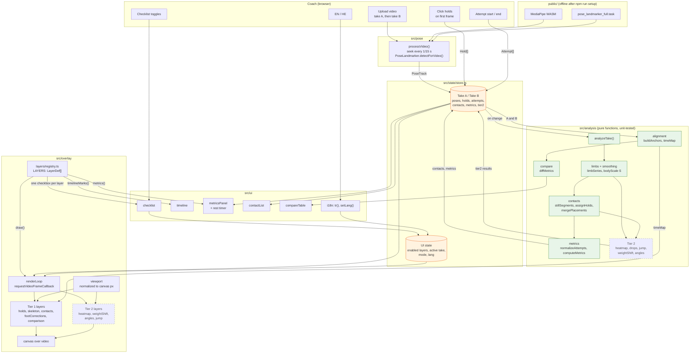
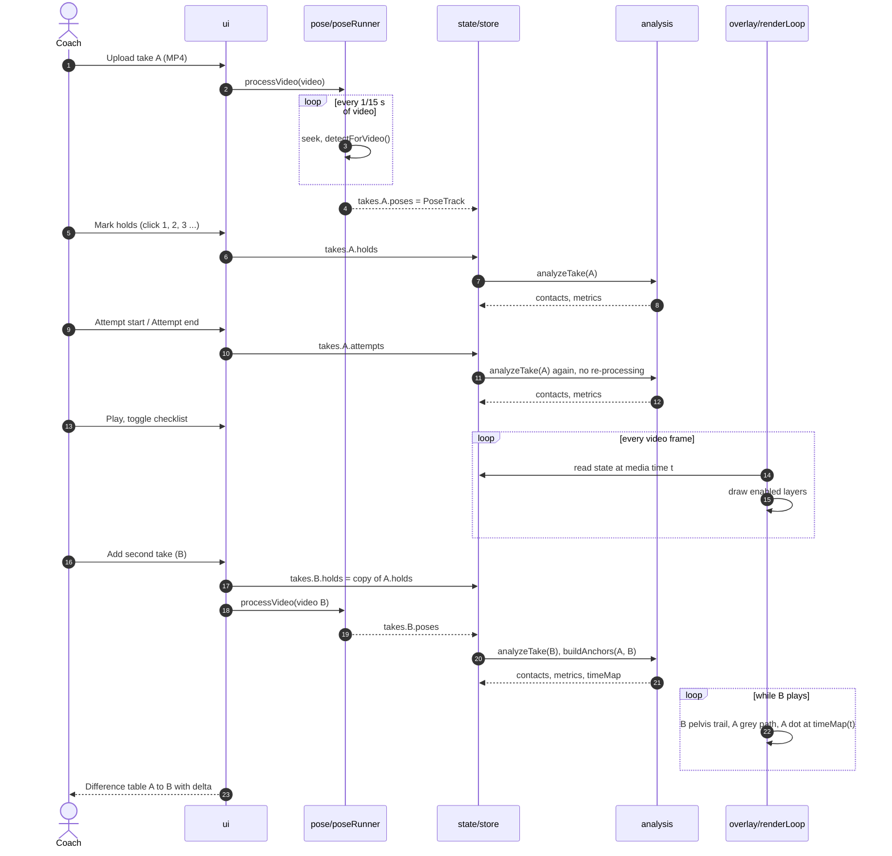
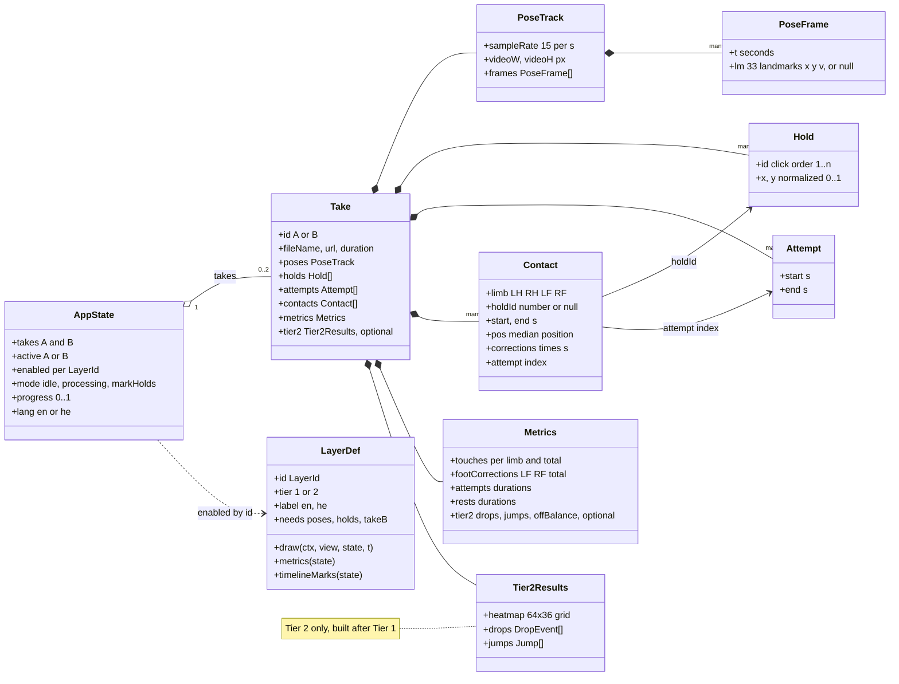

# ClimbingLens: Architecture Diagram

מסמך זה מציג את הארכיטקטורה המוצעת של ClimbingLens בשלושה תרשימים, ולכל אחד הסבר בעברית.
הפירוט המלא (טיפוסים, חתימות פונקציות וספים) נמצא בקובץ <bdi>ARCHITECTURE.md</bdi>. ההחלטות מתועדות בקובץ <bdi>DECISIONS.md</bdi> ומסומנות D ומספר.

**מקרא:**
- רכיב עם **מסגרת מקווקוות** שייך ל-Tier 2. הוא ייבנה רק אחרי ש-Tier 1 עובד מקצה לקצה.
- רכיב **ירוק** הוא פונקציה טהורה שיש לה בדיקות יחידה.
- רכיב **כתום** הוא מקור האמת היחיד של האפליקציה (ה-store).

## 1. Components and data flow

### הסבר

**הרעיון המרכזי:** הכול רץ בדפדפן, בלי שרת, בלי מפתח API ובלי תשלום (החלטה D2). הסרטון לא יוצא מהמחשב.

**1. קלט מהמאמן.** המאמן מעלה סרטון ומסמן את האחיזות בלחיצות על הפריים הראשון. האחיזות ממוספרות לפי סדר הלחיצה. הוא מסמן התחלה וסוף לכל ניסיון, ומדליק או מכבה שכבות ברשימת הסימון.

**2. קבצים מקומיים (<bdi>public</bdi>).** מודל MediaPipe וקובצי ה-WASM מועתקים למחשב פעם אחת, בפקודה <bdi>npm run setup</bdi>. מאותו רגע האפליקציה עובדת גם בלי אינטרנט, וזה חשוב ביום ההדגמה (D9).

**3. זיהוי תנוחה (<bdi>pose</bdi>).** מיד אחרי ההעלאה, הפונקציה <bdi>processVideo</bdi> עוברת על הסרטון בקפיצות של <bdi>1/15</bdi> שנייה. בכל פריים היא מריצה את המודל ושומרת 33 נקודות גוף. התוצאה נשמרת כ-<bdi>PoseTrack</bdi>. העיבוד רץ פעם אחת בלבד, ובזמן הניגון המודל לא רץ בכלל (D11).

**4. מצב האפליקציה (<bdi>store</bdi>).** זה מקור אמת יחיד. הוא שומר את שני הניסיונות, A ו-B, עם כל הנתונים של כל אחד. הוא שומר גם אילו שכבות מסומנות, את השפה ואת המצב הנוכחי. כל רכיבי הממשק מאזינים לשינויים בו ומציירים את עצמם מחדש.

**5. ניתוח (<bdi>analysis</bdi>).** אלה פונקציות טהורות: הן מקבלות מערכים ומחזירות מערכים, בלי DOM ובלי MediaPipe, ולכן קל לבדוק אותן. השרשרת:
- **נקודת גפה:** נקודת היד היא ממוצע של שורש כף היד, האצבע והזרת. נקודת הרגל היא ממוצע של העקב והבוהן. אחר כך ממלאים פערים קצרים ומחליקים את התנועה (D14, D17).
- **מגע:** פרק זמן של 0.3 שנייה לפחות שבו הגפה כמעט לא זזה. כל מגע משויך לאחיזה הקרובה אליו, אם היא בתוך הרדיוס (D15).
- **תיקון רגל:** הרגל זזה ונחה שוב על אותה אחיזה בלי לעזוב אותה. תיקון נספר בנפרד, ולא כמגע נוסף (D16).
- **מדדים:** מספר המגעים של כל גפה, מספר תיקוני הרגל, משך כל ניסיון ומשך כל מנוחה.

הניתוח רץ מחדש תוך אלפיות שנייה, בכל פעם שמוסיפים אחיזה או מסמנים ניסיון. אין צורך לעבד את הסרטון מחדש.

**6. שכבות ותצוגה (<bdi>overlay</bdi>).** רשימה אחת, <bdi>LAYERS</bdi>, מגדירה את כל השכבות. מכל שכבה ברשימה נוצרת שורה ברשימת הסימון. לכל שכבה יש עד שלוש נקודות חיבור:
- ציור על הווידאו (<bdi>draw</bdi>)
- שורות בלוח המדדים (<bdi>metrics</bdi>)
- סימנים על ציר הזמן (<bdi>timelineMarks</bdi>)

בכל פריים, לולאת הציור קוראת רק לשכבות המסומנות, לפי הסדר שלהן ברשימה. הוספת מדד חדש פירושה הוספת רשומה אחת לרשימה (D25, D32).

**7. ממשק (<bdi>ui</bdi>).** הממשק כולל את רשימת הסימון, ציר הזמן, לוח המדדים עם שעון מנוחה, רשימת רצף המגעים, טבלת ההשוואה ומתג השפה. כל הטקסט עובר דרך מילון עברית ואנגלית, והפריסה מתהפכת אוטומטית לימין-לשמאל בעברית (D10).

**8. השוואה בין שני ניסיונות.** לניסיון B מועתקות האחיזות של A, כי המצלמה והמסלול זהים (D20). כדי שהשוואה תהיה הוגנת גם כשהקצב שונה, הזמנים מיושרים לפי **הרגע הראשון שבו כל אחיזה נגעה** בכל ניסיון. למשל, "תנועה 4" ב-B מוצבת מול "תנועה 4" ב-A. בין העוגנים האלה הזמן נמתח באופן ליניארי (D21).

## 2. Event sequence during a demo

### הסבר

התרשים עוקב אחרי תסריט ההדגמה (סעיף 11 ב-<bdi>SPEC.md</bdi>):

1. **העלאת ניסיון A.** מופיע פס התקדמות בזמן העיבוד. סרטון של דקה אמור להיות מוכן תוך פחות מדקה. זו ההגדרה של "זמן אמת" בפיץ': המשוב מוכן לפני הניסיון הבא.
2. **סימון אחיזות.** המאמן לוחץ על האחיזות לפי הסדר. כל לחיצה מפעילה מחדש את הניתוח, ורשימת המגעים מתעדכנת מיד.
3. **סימון ניסיונות.** בכפתורי "תחילת ניסיון" ו"סוף ניסיון" מסמנים קטעים. הפערים בין הקטעים הם המנוחות. המגעים נספרים רק בתוך ניסיונות.
4. **ניגון.** בכל פריים לולאת הציור קוראת את המצב לפי זמן הווידאו ומציירת רק את השכבות המסומנות.
5. **ניסיון B.** הוא מקבל את האחיזות של A, עובר עיבוד וניתוח, ואז נבנים העוגנים ליישור הזמן.
6. **השוואה.** בזמן ש-B מתנגן מוצגים שלושה דברים: מסלול האגן של B בצבע, המסלול המלא של A באפור, ונקודה אפורה במקום שבו היה האגן של A באותו "שלב" של המסלול. מתחת לווידאו מופיעה טבלת הפרשים, למשל "תיקוני רגל: 6 ← 2".

## 3. Data structures

### הסבר

- **<bdi>AppState</bdi>** הוא המצב כולו. הוא מכיל עד שני ניסיונות ואת רשימת השכבות המסומנות.
- **<bdi>Take</bdi>** הוא ניסיון אחד, כלומר סרטון אחד. הוא מכיל את כל מה שחושב עליו: נקודות הגוף, האחיזות, קטעי הניסיונות, המגעים והמדדים.
- **<bdi>PoseTrack</bdi>** הוא התוצאה הגולמית של המודל: 15 דגימות בשנייה, ובכל דגימה 33 נקודות גוף. אם לא זוהה אדם בפריים, הערך הוא <bdi>null</bdi>.
- **<bdi>Contact</bdi>** הוא הנחה אחת של גפה. המבנה שומר איזו גפה זו, על איזו אחיזה (או "ללא אחיזה"), מתי ההנחה התחילה ונגמרה, ובאילו רגעים הרגל תוקנה על אותה אחיזה.
- **<bdi>Metrics</bdi>** מכיל את המספרים שמוצגים בלוח ובטבלת ההשוואה. מדדי Tier 2 הם שדה אופציונלי, כדי שבניית Tier 1 לא תהיה תלויה בהם.
- **<bdi>LayerDef</bdi>** הוא הגדרה של שכבה אחת ברשימת הסימון, כולל איפה היא מופיעה: על הווידאו, בלוח המדדים ועל ציר הזמן.

**שתי מוסכמות חשובות** (D13):
1. כל המיקומים נשמרים **מנורמלים**, כלומר כמספר בין 0 ל-1 ביחס לרוחב ולגובה של הווידאו. כך הם לא מושפעים משינוי גודל החלון או מפסים שחורים בצדדים.
2. מרחקים ומהירויות נמדדים ב**יחידות של אורך גו** (S, המרחק מאמצע הכתפיים לאמצע האגן). כך הספים עובדים באותו אופן בין שהמטפס קרוב למצלמה ובין שהוא רחוק ממנה.

## 4. Where each metric is computed

| מדד | שלב | חישוב | תצוגה |
|---|---|---|---|
| שלד (stick figure) | 1 | <bdi>pose/poseRunner.ts</bdi> | שכבת <bdi>skeleton</bdi> |
| מספרי אחיזות וסימוני מגע | 1 | <bdi>ui/holdMarker.ts</bdi>, <bdi>analysis/contacts.ts</bdi> | שכבות <bdi>holds</bdi> ו-<bdi>contacts</bdi>, רשימת מגעים, ציר זמן |
| מספר מגעים | 1 | <bdi>analysis/metrics.ts</bdi> | לוח מדדים |
| תיקוני רגל | 1 | <bdi>analysis/contacts.ts</bdi>, <bdi>metrics.ts</bdi> | נקודה מהבהבת על הרגל, לוח מדדים |
| משך ניסיון ומנוחה | 1 | <bdi>analysis/metrics.ts</bdi> | ציר זמן, שעון מנוחה |
| השוואת שני ניסיונות | 1 | <bdi>analysis/alignment.ts</bdi>, <bdi>compare.ts</bdi> | שכבת <bdi>comparison</bdi>, טבלת הפרשים |
| מפת חום של הרגליים | 2 | <bdi>analysis/heatmap.ts</bdi> | שכבת <bdi>heatmap</bdi> |
| העברת משקל | 2 | <bdi>analysis/weightShift.ts</bdi> | קו אנכי מהאגן, אדום כשיוצא מהטווח |
| זוויות מפרקים (מרפקים) | 2 | <bdi>analysis/angles.ts</bdi> | תוויות על השלד, בדו-ממד |
| נפילת יד או רגל | 2 | <bdi>analysis/drops.ts</bdi> | סימנים אדומים על ציר הזמן |
| ביצועי קפיצה | 2 | <bdi>analysis/jump.ts</bdi> | חץ מהאגן לפי מהירות, לצד חץ אפור של A |

## 5. עקרונות מנחים

| עיקרון | למה |
|---|---|
| הכול בדפדפן, עובד בלי אינטרנט | אין עלות, אין מפתחות, ואין סיכון שה-Wi-Fi באולם יפיל את ההדגמה |
| העיבוד רץ פעם אחת אחרי ההעלאה, לא בזמן אמת | זמנים מדויקים וניגון חלק. המשוב מוכן לפני הניסיון הבא |
| שכבת הניתוח טהורה ונבדקת | שם נמצאים הבאגים ש"מייצרים מספרים שגויים בשקט" |
| רשימת שכבות אחת | כל מדד חדש הוא תוספת עצמאית, ו-Tier 2 לא משנה קוד של Tier 1 |
| כל הספים בקובץ אחד (<bdi>config.ts</bdi>) | כיוונון על סרטון אמיתי בלי לחפש מספרים בקוד |
| Tier 1 קודם | ההדגמה עובדת מקצה לקצה לפני שמוסיפים מדדים |

